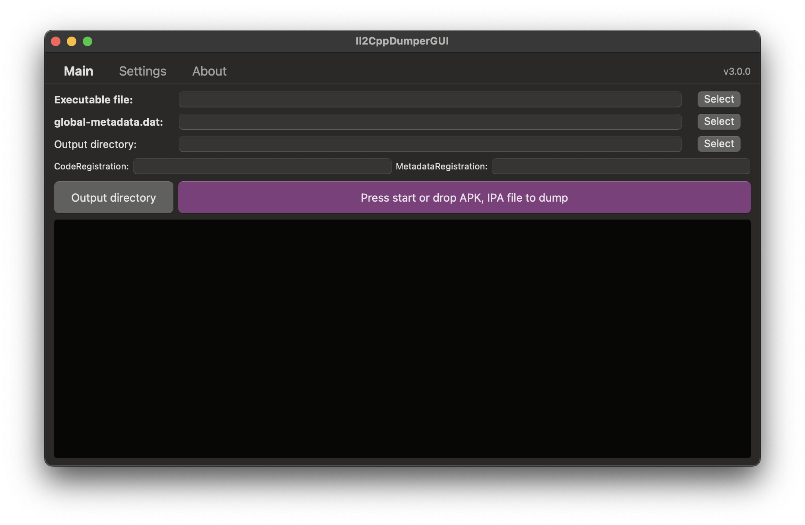

# Il2CppDumper GUI for macOS

Native macOS GUI for the [AndnixSH Il2CppDumper fork](https://github.com/AndnixSH/Il2CppDumper). The app bundles a self-contained CLI for each Mac architecture.

## Features

- **Bundled dumper CLI** — based on AndnixSH/Il2CppDumper at commit `526f7c13`
- **IPA / APK / XAPK / APKS auto-extraction** — drag & drop archive to dump
- **All binary formats** — PE, ELF32/64, Mach-O 32/64, Fat Mach-O, WebAssembly, NSO
- **Metadata versions 16–39 and 104–111** via the bundled fork
- **Full dump output:**
  - `dump.cs` — C# pseudocode (types, methods, fields, properties)
  - `script.json` — for Ghidra / IDA / Binary Ninja
  - `stringliteral.json` — all string literals with addresses
  - `il2cpp.h` — C/C++ header with struct definitions
  - `DummyDll/` — dummy .NET assemblies for dnSpy
- **Configurable dump options** — methods, fields, properties, attributes, offsets
- **Force IL2CPP version** / **Force dump** mode
- **Manual CodeRegistration / MetadataRegistration** input
- **Script auto-copy** — Ghidra, IDA, Binary Ninja, Hopper scripts
- **Drag & Drop** — drop files directly onto the start button
- **Localization** — English / Russian
- **Universal binary** — Apple Silicon (arm64) + Intel (x86_64)
- **macOS 12.0+** compatible

## Screenshots

| Main | Settings | About |
|------|----------|-------|
|  |  |  |

## How It Works

The GUI invokes the bundled, self-contained Il2CppDumper CLI. The same process creates
`dump.cs`, structure files, and `DummyDll/`; its exit status and log are shown in the GUI.
The older native C++ port remains in the tree for reference but is no longer the dump path.
The forked CLI source is vendored in `vendor/AndnixSH` with its license.

## Usage

1. Open the app
2. Drag & drop an IPA, APK, or XAPK file onto the **Start** button
   - Or manually select executable, global-metadata.dat, and output directory
3. Press **Start** — dump.cs and all supporting files will be generated

## Building

### Requirements
- Xcode 14+
- macOS 12.0+
- .NET 10 SDK (to build the bundled CLI)

### Build Steps

```bash
# Clone
git clone https://github.com/Leeksov/Il2CppDumperGUI.git
cd Il2CppDumperGUI

# Build the self-contained arm64 and x64 dumper CLIs
./build_postprocess.sh

# Open in Xcode and build
open Il2CppDumperGUI.xcodeproj
```

## Credits

- [AndnixSH](https://github.com/AndnixSH/Il2CppDumper) — current dumper core and CLI (vendored at `526f7c13`)
- [Perfare](https://github.com/Perfare/Il2CppDumper) — Il2CppDumper (core dumping logic)
- [djkaty](https://github.com/djkaty/Il2CppInspector) — Il2CppInspector (contributions)

## License

This project is for educational and research purposes.
