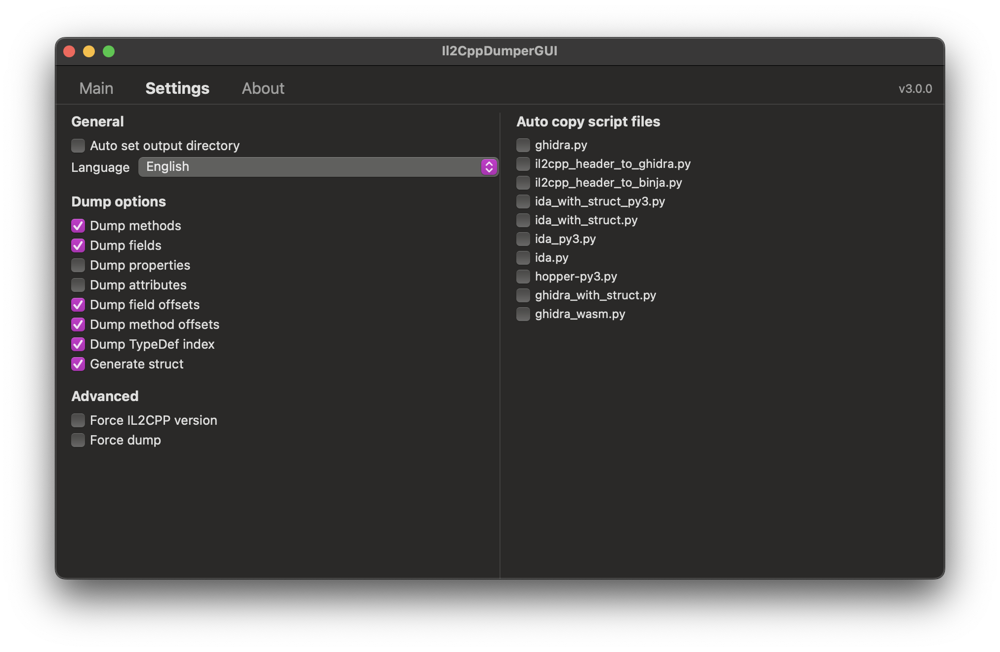
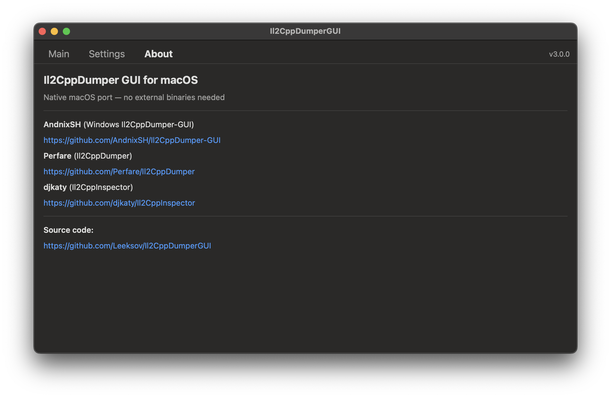

# Il2CppDumper GUI for macOS

Native macOS GUI for [Il2CppDumper](https://github.com/Perfare/Il2CppDumper) with a C++ engine linked into the app.

## Features

- **One executable** — native C++ parsing and output generation run inside the macOS app
- **IPA / APK / XAPK / APKS auto-extraction** — drag & drop archive to dump
- **All binary formats** — PE, ELF32/64, Mach-O 32/64, Fat Mach-O, WebAssembly, NSO
- **IL2CPP metadata versions 16–31, 33, 35, 38, 39 and 104–111** with automatic version detection
- **Full dump output:**
  - `dump.cs` — C# pseudocode (types, methods, fields, properties)
  - `script.json` — for Ghidra / IDA / Binary Ninja
  - `stringliteral.json` — all string literals with addresses
  - `il2cpp.h` — C/C++ header with struct definitions
  - `DummyDll/` — dummy .NET assemblies for dnSpy
- **Configurable dump options** — methods, fields, properties, attributes, offsets
- **Force IL2CPP version** / **Force dump** mode
- **Manual CodeRegistration / MetadataRegistration** input
- **Script auto-copy** — Ghidra, IDA, Binary Ninja, Hopper scripts
- **Drag & Drop** — drop files directly onto the start button
- **Localization** — English / Russian
- **Universal binary** — Apple Silicon (arm64) + Intel (x86_64)
- **macOS 12.0+** compatible

## Screenshots

| Main | Settings | About |
|------|----------|-------|
|  |  |  |

## How It Works

1. The SwiftUI app extracts IPA/APK archives and selects the IL2CPP files.
2. The linked C++ engine in `NativeEngine/` parses the files once and generates all outputs.

## Usage

1. Open the app
2. Drag & drop an IPA, APK, or XAPK file onto the **Start** button
   - Or manually select executable, global-metadata.dat, and output directory
3. Press **Start** — dump.cs and all supporting files will be generated

## Building

### Requirements
- Xcode 14+
- macOS 12.0+
- CMake 3.16+

### Build Steps

```bash
# Clone
git clone https://github.com/Leeksov/Il2CppDumperGUI.git
cd Il2CppDumperGUI

# Open in Xcode and build; Xcode links the native engine automatically
open Il2CppDumperGUI.xcodeproj
```

## Credits

- [AndnixSH](https://github.com/AndnixSH/Il2CppDumper-GUI) — Windows Il2CppDumper-GUI (original GUI design)
- [Perfare](https://github.com/Perfare/Il2CppDumper) — Il2CppDumper (core dumping logic)
- [rodroidmods](https://github.com/rodroidmods/Il2cppdumper-cpp) — C++ struct and dummy assembly generators
- [djkaty](https://github.com/djkaty/Il2CppInspector) — Il2CppInspector (contributions)

## License

This project is for educational and research purposes.
